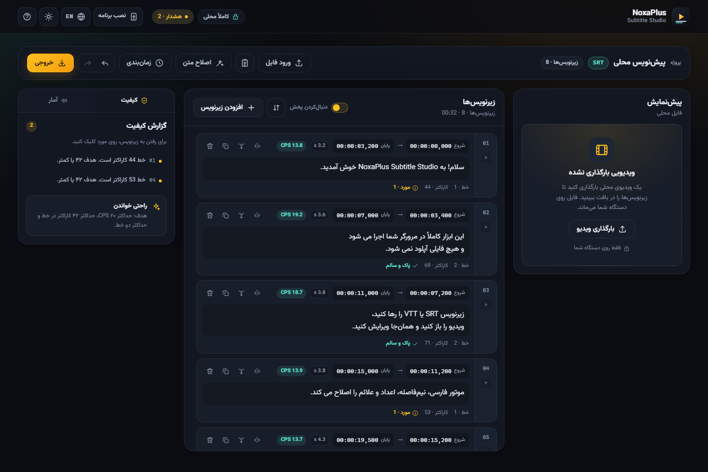
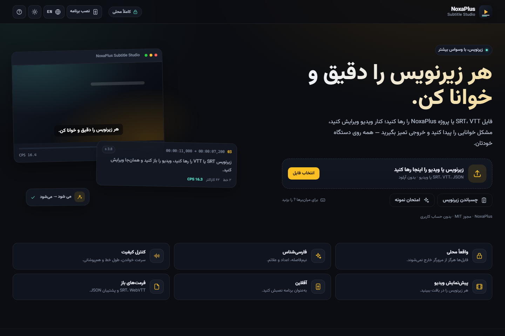
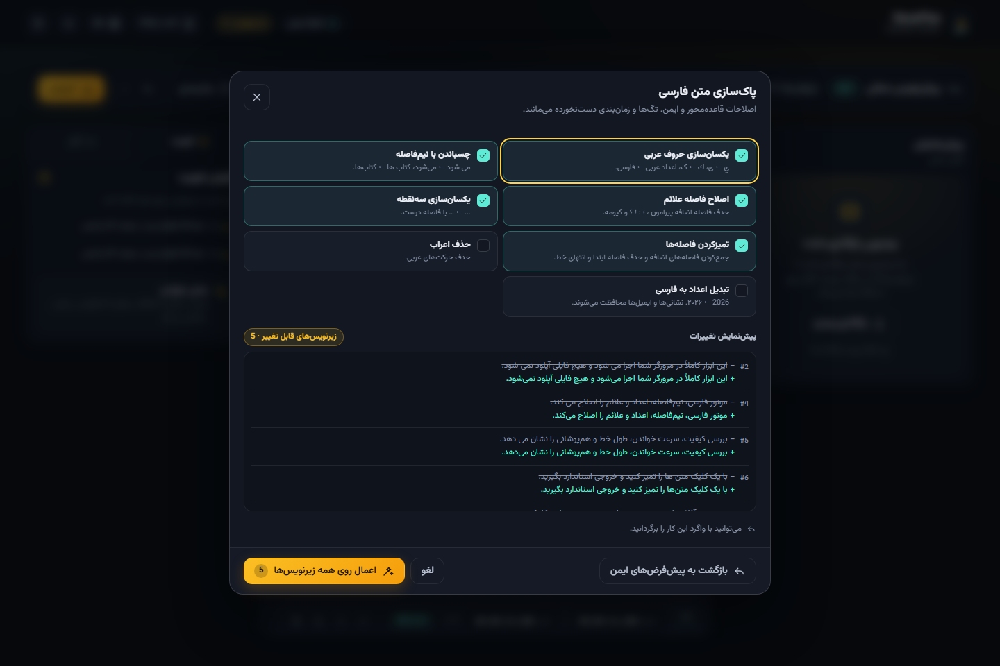
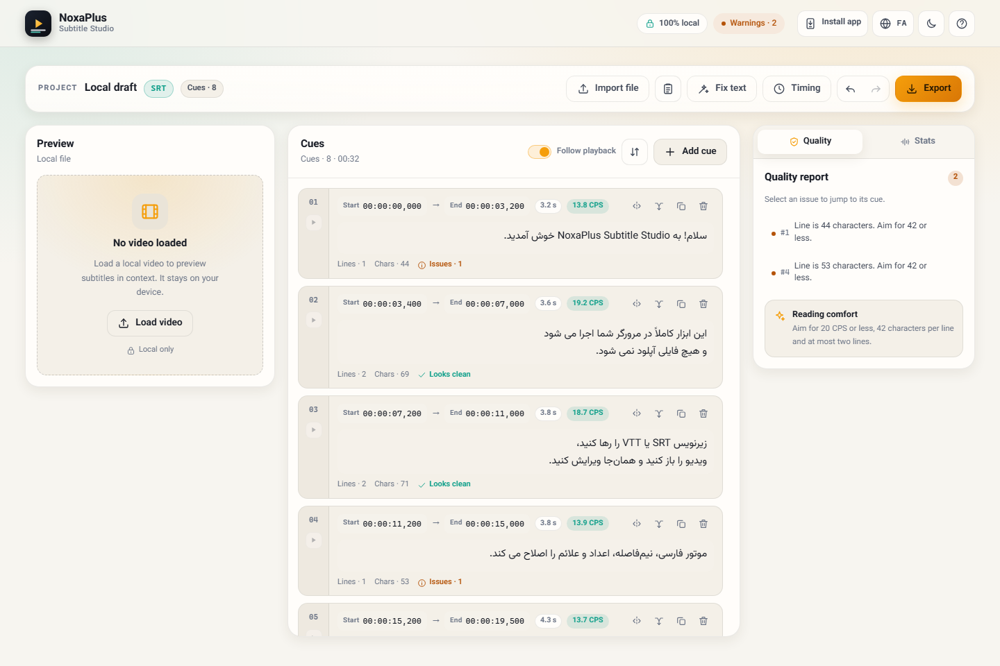
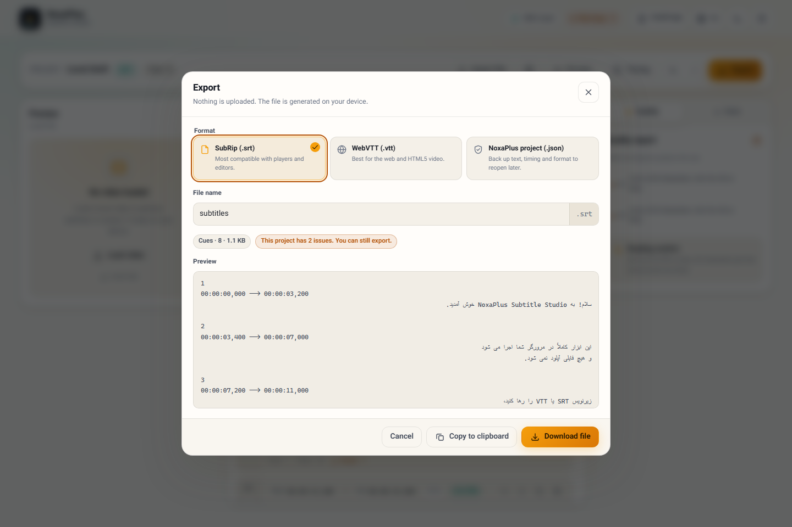
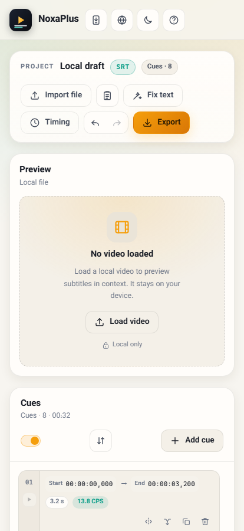

# NoxaPlus Subtitle Studio

**A privacy-first, Persian-first subtitle workbench that runs entirely in your browser.**

[](https://github.com/noxaplus-star/noxaplus-subtitle-studio/actions/workflows/ci.yml)
[](https://github.com/noxaplus-star/noxaplus-subtitle-studio/actions/workflows/deploy.yml)
[](LICENSE)
[](#privacy-and-offline-use)

NoxaPlus Subtitle Studio is a local-first editor for SRT and WebVTT subtitles, with a
first-class Persian text engine and a complete English interface. Import a subtitle file,
fix timing and text, check readability, preview against a local video, and export —
without uploading anything to a server. There is no backend, no account, no API key, and
no telemetry.

**Live demo:** https://noxaplus-star.github.io/noxaplus-subtitle-studio/

**Official website:** https://www.noxaplus.ir



## Highlights

- **Persian-first, fully bilingual.** Native RTL layout, Vazirmatn typography, Persian
  digits, correct punctuation and half-space handling — plus a one-click English UI.
- **Truly local.** Subtitle files and videos stay on your device. The app makes no
  application network requests and works offline after the first load.
- **Readability checks.** Per-cue validation for reading speed (CPS), cue duration,
  line length, line count, overlaps, and empty or invalid timing.
- **Persian text cleanup.** Seven independent, tag-aware rules with a live before/after
  preview and full undo.
- **Practical editing tools.** Split, merge, duplicate, sort, shift, and scale cues;
  edit text and timing inline; undo and redo across the whole project.
- **Video-aware preview.** Load a local video, see the active cue on top of it, seek from
  any cue, and optionally follow playback.
- **Installable and offline.** A web app manifest and service worker provide an
  app-like, offline-capable experience on supported browsers.

## Screenshots

| Landing page (Persian) | Persian text cleanup |
| --- | --- |
|  |  |

| Editor (English, light) | Export dialog |
| --- | --- |
|  |  |

| Mobile layout |
| --- |
|  |

## Features

### Import

- **SRT**, **WebVTT**, and **NoxaPlus project JSON** files.
- Open with the file picker, drag and drop anywhere in the editor, or paste text with the
  Paste action.
- Tolerates UTF-8 BOM and CRLF newlines.
- Skips malformed blocks and reports how many were skipped instead of failing silently.
- Reads WebVTT cue identifiers and ignores `NOTE`, `STYLE`, and `REGION` blocks.
- Loads a JSON project with its original preferred export format.

### Edit

- Inline editing of cue text and start/end timestamps.
- Add a cue after the selection or at the end.
- Split a cue at a word or line boundary, preserving its duration.
- Merge a cue with the next one, duplicate a cue after itself, or delete it.
- Sort all cues by time, shift every cue forward or backward, or scale the whole timeline.
- Undo and redo for every project change, including edits made inside text fields.
  History keeps the last 80 snapshots and coalesces typing into single steps.

### Validate

The quality report updates as you type and groups issues by severity. Click an issue to
jump to its cue.

| Check | Rule | Severity |
| --- | --- | --- |
| Negative timing | Start or end is below zero | Error |
| End before start | End is less than or equal to start | Error |
| Overlapping cues | A cue starts before the previous cue ends | Error |
| Reading speed | More than 25 characters per second | Error |
| Reading speed | More than 20 characters per second | Warning |
| Short cue | Shown for less than 700 ms | Warning |
| Long cue | Shown for more than 8 seconds | Info |
| Too many lines | More than 2 visible lines | Warning |
| Long line | A visible line longer than 42 characters | Warning |
| Empty text | Cue has no visible text | Warning |

The Stats tab summarizes total cues, duration, words, characters, average CPS, maximum CPS,
and the longest visible line.

### Persian text cleanup

All rules are optional and can be combined. They only touch text, never tags or timing.

| Rule | Example |
| --- | --- |
| Normalize Arabic characters | `ي` / `ى` → `ی`, `ك` → `ک`, Arabic-Indic digits → Persian digits |
| Join with half-space (ZWNJ) | `می شود` → `می‌شود`, `کتاب ها` → `کتاب‌ها` |
| Fix punctuation spacing | Removes stray spaces before `،` `؛` `:` `!` `؟` `.` and after `«` `(` |
| Normalize ellipsis | `...` → `…` with correct spacing |
| Clean whitespace | Collapses repeated spaces and trims every line |
| Remove diacritics | Strips Arabic vowel marks |
| Convert digits to Persian | `2026` → `۲۰۲۶`, with URLs and email addresses protected |

The dialog previews every changed cue with a `−` before line and a `+` after line. Nothing
is applied until you confirm, and the whole operation can be undone in one step.

### Preview and timing

- Load a local video (MP4, WebM, or any format your browser can play). It is never uploaded
  or copied into app storage.
- Play, pause, seek, and use the browser's native video controls.
- The active subtitle is drawn over the video using its plain text.
- Click the play button on a cue to seek to it.
- "Follow playback" keeps the active cue scrolled into view.

### Export

- **SubRip (`.srt`)**, **WebVTT (`.vtt`)**, or **NoxaPlus project (`.json`)**.
- Choose a file name, inspect the generated byte size and current issue count, and preview
  the output before saving.
- Copy to the clipboard or download the file. Cues are always sorted by time on export.

### Data and preferences

- The current project, format, file name, language, theme, and playback-follow preference
  are autosaved to `localStorage` (debounced) and restored on the next visit.
- Invalid or oversized stored drafts are rejected safely.
- If browser storage is full, the app warns once instead of losing edits silently.

### Accessibility and platform

- Full keyboard navigation, visible focus rings, labelled controls, and modal focus
  trapping with `Esc` to close.
- Semantic landmarks, skip link, and `aria-live` toast announcements.
- Respects `prefers-reduced-motion`.
- Responsive from small phones to wide desktop layouts.
- Dark and light themes, Persian and English, with per-user persistence.

## Keyboard shortcuts

| Action | Shortcut |
| --- | --- |
| Undo | `Ctrl` / `⌘` + `Z` |
| Redo | `Ctrl` / `⌘` + `Shift` + `Z` |
| Import subtitles | `Ctrl` / `⌘` + `O` |
| Open export dialog | `Ctrl` / `⌘` + `E` |
| Play / pause video | `Space` (when focus is not in a field) |
| Open help | `?` |
| Close dialog | `Esc` |

Undo and redo work even while the focus is inside a cue text field.

## Supported formats

| Format | Import | Export | Notes |
| --- | --- | --- | --- |
| SubRip (`.srt`) | Yes | Yes | Indexes are regenerated; text is preserved as written. |
| WebVTT (`.vtt`) | Yes | Yes | Cue settings are not preserved; `NOTE`, `STYLE`, and `REGION` blocks are skipped. |
| NoxaPlus project (`.json`) | Yes | Yes | Stores format plus `start`, `end`, and `text` for each cue. |

NoxaPlus project files look like this:

```json
{
  "app": "noxaplus-subtitle-studio",
  "version": 1,
  "format": "srt",
  "cues": [
    { "start": 0, "end": 3200, "text": "First subtitle line" }
  ]
}
```

Timestamps are integer milliseconds.

## Quick start

Requirements: **Node.js 20 or newer** and npm.

```bash
git clone https://github.com/noxaplus-star/noxaplus-subtitle-studio.git
cd noxaplus-subtitle-studio
npm install
npm run dev
```

Open the printed local URL. No environment variables or services are required.

### Scripts

| Command | What it does |
| --- | --- |
| `npm run dev` | Start the Vite development server. |
| `npm run build` | Type-check and build the production site into `dist/`. |
| `npm run preview` | Serve the production build locally. |
| `npm run typecheck` | Run TypeScript without emitting files. |
| `npm test` | Run the unit test suite once. |
| `npm run test:watch` | Run tests in watch mode. |
| `npm run icons` | Regenerate app icons and the Open Graph image from the logo. |

## Privacy and offline use

- No accounts, analytics, cookies, tracking pixels, or third-party runtime scripts.
- No subtitle, video, or project data ever leaves the browser.
- Videos are read locally through the browser's object URLs and are not persisted.
- Drafts and preferences live in `localStorage` on your device and can be cleared with your
  browser's site-data controls.
- The Vazirmatn font is bundled with the app rather than loaded from a CDN.
- In production, a service worker caches the app shell so the editor can reopen offline.
- Copy-to-clipboard and installation depend on browser support and secure context; the app
  degrades gracefully when they are unavailable.

## Architecture

The subtitle engine is framework-free TypeScript, so it can be reused, tested, or ported.

```text
src/
  core/            Pure subtitle logic and unit tests
    parse.ts       SRT / WebVTT parsing, BOM and CRLF handling
    serialize.ts   SRT / WebVTT output
    project.ts     NoxaPlus JSON project format
    persian.ts     Tag-aware Persian text cleanup
    validation.ts  CPS, timing, line-length, and overlap checks
    operations.ts  Split, merge, shift, scale, sort, duplicate
    time.ts        Timestamp parsing and formatting
    text.ts        Visible text, line and word counting, CPS
  components/      React UI (editor, dialogs, panels, toolbar)
  hooks/           Project history, local video, install prompt
  i18n.tsx         Typed Persian and English dictionaries
  storage.ts       Validated localStorage persistence
  App.tsx          App shell, import/export flows, shortcuts
  styles.css       Design tokens and responsive layout
```

- **React 19** with **TypeScript** and **Vite**.
- Plain CSS with logical properties for RTL/LTR support; no UI framework.
- **Vitest** for the subtitle engine: parsing, serialization, Persian rules, validation,
  operations, and project files.
- Strict TypeScript settings, including `noUnusedLocals` and `noUnusedParameters`.

### Tests

```bash
npm run typecheck
npm test
npm run build
```

The suite currently contains 73 unit tests across six files.

## Deploying

The repository includes a GitHub Pages workflow. On every push to `main`, it installs
dependencies, runs the tests, builds the site, and publishes `dist/`.

1. Push the repository to GitHub.
2. Open **Settings → Pages** and set **Source** to **GitHub Actions**.
3. The site is published at `https://<owner>.github.io/noxaplus-subtitle-studio/`.

Any static host works as well: run `npm run build` and serve the `dist/` folder. The Vite
base is relative, so the build works from a subdirectory.

## Roadmap

- Automatic line wrapping at configurable character limits.
- Find and replace across cues, with regex support.
- Side-by-side translation tracks.
- Additional export presets for broadcast and streaming workflows.
- Optional keyboard shortcuts for adding and deleting cues.

Ideas and bug reports are welcome in
[GitHub Issues](https://github.com/noxaplus-star/noxaplus-subtitle-studio/issues).

## Contributing

Contributions are welcome. Please read [CONTRIBUTING.md](CONTRIBUTING.md) before opening a
pull request. In short:

1. Fork the repository and create a focused branch.
2. Add or update tests for behavior changes in `src/core/`.
3. Run `npm run typecheck && npm test && npm run build`.
4. Open a pull request describing the problem and the solution.

By participating, you agree to follow the [Code of Conduct](CODE_OF_CONDUCT.md). For
security issues, please follow [SECURITY.md](SECURITY.md) instead of opening a public issue.

## License

Released under the [MIT License](LICENSE). Copyright (c) 2026 NoxaPlus.

The NoxaPlus name and logo identify this project and its official distribution; the MIT
license applies to the source code.

## Contact

- **NoxaPlus** — [NoxaPlus2025@gmail.com](mailto:NoxaPlus2025@gmail.com)
- Official website: [www.noxaplus.ir](https://www.noxaplus.ir)
- GitHub: [@noxaplus-star](https://github.com/noxaplus-star)
- Repository: [noxaplus-star/noxaplus-subtitle-studio](https://github.com/noxaplus-star/noxaplus-subtitle-studio)

See [CHANGELOG.md](CHANGELOG.md) for release history.
